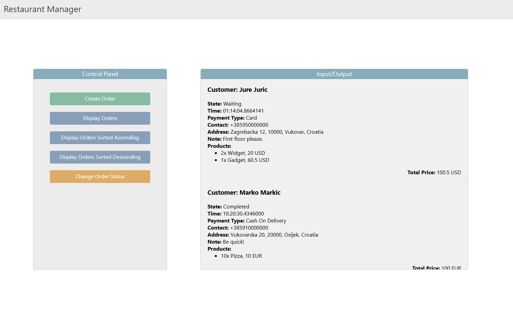
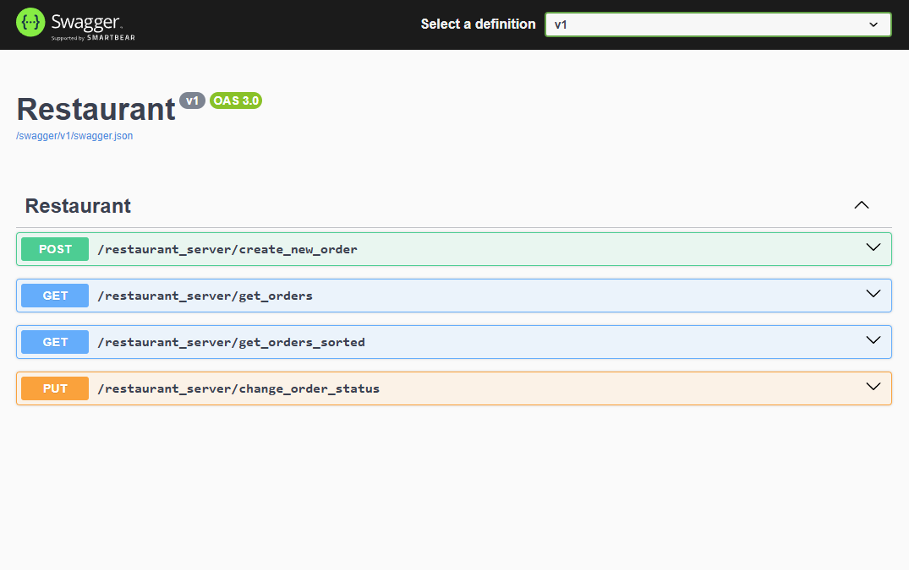

Projekt za upravljanje naruđbama u restoranu.

Potrebno je instalirati Microsoft SQL Express i po potrebi SQL Server Management Studio 21 (ako želite ručno uređivati bazu podataka).

Projekt je izrađen u Visual Studio 22. 

Kako bi ste pokrenuli backend dio aplikacije potrebno je otvoriti soluciju i promijeniti ime servera unutar dvije datoteke, appsettings.json i appsettings.Development.json (nije vidljiva u Solution Exploreru).

Ime servera ujedino je i ime računala u vidu alfanumeričkih znakova. Vidljivo u Windows postavkama pod "Device name".

Klikom na tekst "https" u vidu Build tipke aplikacija se pokreće. Otvara se konzolna aplikacija u kojoj je potrebno pronaći URL koji sadrži https putanju i pripadni port. Npr: https://localhost:7056/index.html

Kako bi ste pokrenuli frontend dio aplikacije potrebno je otvoriti direktorij Frontend unutar Visual Studio Code-a i pokrenuti naredbu "npm start". Potrebno je na računali imati instaliran node.js i npm, sa pripadajućim putanjama.

Prije pokretanja frontend aplikacije potrebno je pokrenuti backend aplikaciju.

Ukoliko dođe do problema prilikom komunikacije s bazom podataka, provjeriti postavke vatrozida i dopustite TCP vezu uz port 1433 koristeći SQL Server 2022 Configuration Manager. (Network configuration -> Protocols for SQLEXPRESS (ime odabrano prilikom instlacije) -> "TCP/IP" i "Named Pipes" postaviti u Enabled. Dvoklikom na TCP/IP -> IP Addresses -> Kategorija IPAll -> TCP Port -> 1433 
